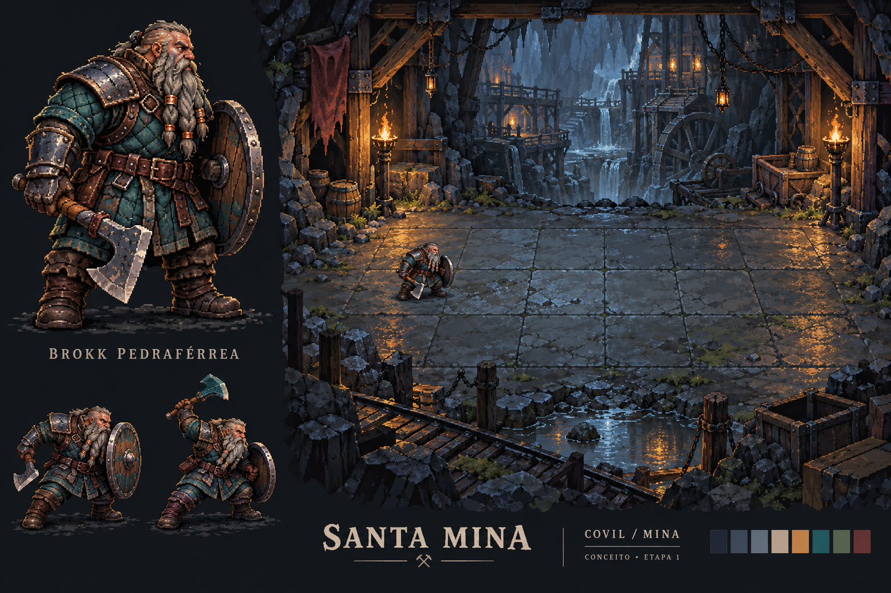

# Santa Mina — direção artística, etapa 1

> **Direção atual — 24/10/2026:** protagonista Zeno, Humano Guerreiro, com espada,
> escudo, metal e tecido verde. O atlas provisório atual tem sete animações.
> Songs of Conquest e a direção de criaturas indicada de Luiz Melo são referências
> de qualidade geral; nenhum asset comercial foi copiado. As pranchas e relatórios
> de Brokk abaixo são registros do protótipo anterior. Ver `../ATUALIZACAO_ZENO.md`.

> Integração atual: [sete inimigos, quatro ambientes, cartas e apresentação do chefe](ENTREGA_VISUAL_01.md).
> As seções de proposta abaixo registram o planejamento original.

> Primeiro adversário original: [Bandido Arqueiro humano](ARQUEIRO_ANIMADO_V01.md),
> com cabeça menor e proporções de tronco/pernas revisadas a pedido do usuário.

> Estado mais recente: [Brokk com sete animações](BROKK_ANIMADO_V02.md).

Status: conceito v01 aprovado pelo usuário. A primeira integração de Brokk com
idle e ataque está em [BROKK_ANIMADO_V01.md](BROKK_ANIMADO_V01.md). As demais
seções preservam a proposta e o planejamento; não significam que todos os assets
estão prontos. Referência principal: GDD Godot 4 v2.1 de 22/10/2026.

## Escopo e decisões preservadas

- Zeno, Humano Guerreiro, é o único protagonista atual; Brokk é legado interno.
- Grade lógica de 3 linhas e 6 colunas, regras, PA, dados, cartas e campanha
  continuam intactos. Não criar classes, habilidades ou regras novas.
- Golpe Sujo e Me Protejam! já estão implementados e testados. O trabalho
  futuro é sua apresentação visual/sonora, sem refazer a lógica.
- Songs of Conquest inspira riqueza da pixel art, iluminação, profundidade e
  leitura tática. Não copiar sprites, composições identificáveis, interfaces,
  personagens, cenários ou áudio desse jogo.
- Não usar 32rogues para produzir novos assets, nem como entrada de geradores.
  Nenhuma imagem do pacote ou captura que o contenha foi enviada ao imagegen.

## Prancha proposta

Arquivo pretendido: `res://assets/concepts/etapa_01/brokk_covil_v01.png`.
Geração: ferramenta integrada ImageGen, sem imagens de referência.
Prompt completo: [PROMPT_CONCEITO_01.txt](PROMPT_CONCEITO_01.txt).

A prancha é um estudo raster de identidade e atmosfera. Não é captura do jogo,
spritesheet, tileset pronto, teste de animação ou arte final aprovada. A imagem
tem detalhes e perspectiva ilustrativos: a contagem das pedras não define as
casas. A grade real continuará sendo desenhada e clicada pelo Godot em 3×6.
O fundo integrado precisará de camadas, plano de chão e enquadramento próprios.

## Brokk

- Anão compacto, robusto, barba cinza trançada, nariz largo e botas fortes.
- Machado de ferro de uma mão e escudo de madeira com ferragens. Manter ambos
  reconhecíveis em tamanho real de combate, sem depender do retrato ampliado.
- Tecido azul-petróleo, armadura de ferro escuro, couro castanho e detalhes
  contidos de cobre. Sem joias mágicas, armadura real ou poderes não definidos.
- Postura firme de trabalhador guerreiro. O desenho da prancha é uma proposta,
  não um novo fato narrativo canônico.
- Brokk olha para a direita; inimigos para a esquerda. Rever luz e mãos ao
  criar poses opostas: não espelhar indiscriminadamente luz, arma e escudo.

## Paleta base proposta

| Função | Cor |
| --- | --- |
| Sombra profunda | `#171C25` |
| Pedra fria | `#3A4657` |
| Aço iluminado | `#8095A6` |
| Osso/pergaminho claro | `#D2C4A6` |
| Luz âmbar | `#DA9B4A` |
| Tecido de Brokk | `#376D71` |
| Musgo | `#55654E` |
| Acento vinho seco | `#743D41` |

São cores de partida, não limite rígido de oito cores. Usar rampas discretas,
clusters de pixels claros e poucos brilhos. Evitar contorno preto uniforme,
ruído de textura e excesso de saturação em toda a tela.

## Escala e perspectiva para protótipo artístico

- Proposta de sprite: célula de 64×64 px por quadro, com Brokk ocupando cerca
  de 40–48 px de altura corporal. Ataque pode precisar de tela de 96×96 px.
- Pivô comum nos pés; alinhar quadros pelo chão, sem saltos entre animações.
- Validar em uma casa lógica de 88×88 antes de fechar a resolução de produção.
  O tamanho da casa pode ter apresentação adaptada, sem mudar a topologia.
- Câmera lateral com chão visível; volume sugerido por sprites e camadas.
  A prancha oblíqua é estudo de atmosfera, não autorização para converter
  coordenadas do combate em isometria nem mudar o sistema de cliques.
- Sprite nítido com filtro nearest e escala de apresentação preferencialmente
  inteira; não reutilizar automaticamente a escala fracionária atual de 1,8.
  Ajustar enquadramento e espaço da arena antes de aumentar sprites a ponto
  de encobrir casas, dados ou controles.
- UI usa fonte legível e tema próprios. Dados 3D mantêm antialiasing separado;
  não aplicar filtro nearest global aos textos e aos viewports 3D.

## Covil/mina — cenário piloto

Composição original: estrutura de madeira antiga e ferro, pedra molhada, nichos
escuros, caixas nas bordas e vegetação escassa. Sem construir uma cidade ou
inventar história principal nesta fase.

Separar em: fundo distante, estruturas intermediárias, piso, props, primeiro
plano e luzes/FX. O piso central deve ter menos detalhe e contraste que as bordas.
Não desenhar Brokk, a grade ou a interface dentro da textura de cenário final.

Luz principal quente das tochas e preenchimento frio; sombras de contato nos
pés. Luz, partículas e paralaxe discretos, compatíveis com o renderizador atual
e o hardware já usado, sem exigir alteração de backend.

Depois do piloto, derivar estrada/floresta e passagem da caverna com os mesmos
materiais e proporções. Mapas autorais; sem geração de labirintos nesta fase.

## Planejamento inicial de animações — histórico

Proposta de quantidade de quadros, ajustável após teste visual:

| Animação | Quadros | Leitura necessária |
| --- | ---: | --- |
| Idle | 4–6 | Respiração curta, pés estáveis |
| Caminhada | 6–8 | Contato dos pés e peso |
| Corrida | 6–8 | Passada distinta da caminhada |
| Machado | 6–8 | Antecipação → impacto → recuperação |
| Bloqueio | 4–6 | Escudo avança e absorve impacto |
| Dano | 3–4 | Recuo curto, silhueta legível |
| Morte | 6–8 | Queda e quadro final estável |
| Reação/uso de item | 4–6 | Gestos simples conforme evento existente |

Futuros AnimatedSprite2D/AnimationPlayer recebem eventos do combate; não sorteiam
dados e não calculam dano. Impactos se sincronizam ao momento visual do golpe.
Bloquear novas ações durante animação usando o fluxo já existente, sem travar
o combate caso uma animação seja interrompida.

## VFX, áudio e cartas

- Machado: arco curto, faíscas pontuais e impacto; sem interpretar golpe forte
  como crítico novo. Escudo com clarão metálico e recuo contido.
- Flecha: origem na arma e chegada ao alvo resolvido, incluindo fogo amigo.
- Golpe Sujo: gesto/areia e indicação do teste DES/SAB já existente.
- Me Protejam!: gesto e indicação clara do goblin que recebe o dano; nenhum
  deslocamento real de unidade.
- Reutilizar sons sintetizados próprios enquanto se produz áudio mais rico.
  Criar passos, UI, cartas, dados e ambiente posteriormente.
- Manter cartas verticais, custos e textos atuais; substituir ilustrações
  geométricas depois da aprovação da linguagem visual.

## Ordem de produção e critérios de aprovação

1. Aprovar identidade de Brokk, paleta e atmosfera desta prancha.
2. Produzir um sprite idle e uma animação de ataque em escala real. Conferir
   silhueta, pivô, mãos, consistência de equipamento e leitura sobre o piso.
3. Produzir arena piloto em camadas e validar com grade, dados e UI reais.
4. Integrar Brokk e um adversário original; manter regras e testes existentes.
5. Expandir aos sete inimigos e aos cenários dos quatro capítulos.

Antes de integração definitiva: captura real, clique real, números/PA corretos,
sprite sem recortes entre frames, animação sem deslize dos pés e histórico legível.
As autorizações posteriores do usuário permitiram as integrações descritas nos
relatórios; os critérios acima continuam sendo referência de revisão visual.

## Pendências técnicas existentes registradas

- Resolvida em 23/10: a introdução do capítulo IV não diz mais que as habilidades
  do chefe são inativas. Golpe Sujo e Me Protejam conservam as regras existentes.
- Resolvida em 23/10: o combate e a campanha usam sprites próprios para todas as
  sete fichas. A referência 32rogues foi retirada de Combate.tscn; arquivos antigos
  foram preservados no disco.
- A pré-produção não alterou código; as primeiras integrações de Brokk estão
  registradas nos relatórios anteriores. A entrega atual inclui os sete inimigos,
  quatro ambientes e cartas. PV, PA e demais regras foram preservados.
